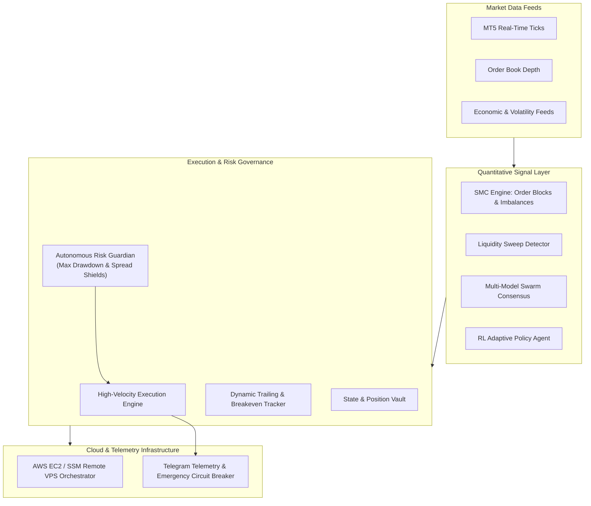

# ⚡ Quant Execution Engine & Cloud Trading Harness

[](https://python.org)
[](https://aws.amazon.com)
[](https://www.metatrader5.com)
[](LICENSE)

An institutional-grade, event-driven quantitative trading framework and cloud execution harness engineered for **MetaTrader 5 (MT5)** and distributed **AWS EC2 / VPS** infrastructure. 

Designed for high-precision trade execution, autonomous risk governance, and quantitative signal generation—incorporating **Smart Money Concepts (SMC)** order-block detection, liquidity sweep analytics, and real-time **Telegram** telemetry.

---

## 🏛️ System Architecture



---

## 🚀 Key Modules & Architecture

### 1. Core Execution Engine (`/core`)
- **`execution_engine.py`**: Event-driven order execution bridge interacting with MetaTrader 5 via IPC pipes, supporting sub-millisecond parameter validation, slippage enforcement, and partial fill reconciliation.
- **`risk_guardian.py`**: Hardened risk-control daemon enforcing mandatory daily drawdown limits, max leverage ceilings, and real-time anomalous margin alerts.
- **`trailing_tracker.py`**: Algorithmic trailing stop and breakeven optimizer adjusting dynamic stops based on Average True Range (ATR) and market structure pivots.
- **`vault_system.py`**: Persistent state management and trade ledger keeping localized state synchronization across distributed VPS restarts.

### 2. Quantitative Strategy Engine (`/strategies`)
- **`smc_engine.py`**: Algorithmic implementation of Smart Money Concepts—detecting institutional order blocks, Fair Value Gaps (FVG), Break of Structure (BOS), and Change of Character (CHoCH).
- **`sweep_detector.py`**: High-frequency liquidity sweep identifier isolating stop-run events on high/low key levels.
- **`scaler_engine.py`**: Adaptive multi-tier position sizing algorithm optimizing capital allocation according to volatility metrics.
- **`swarm_consensus.py`**: Multi-agent consensus mechanism aggregating signal confidence scores across disparate models prior to dispatch.
- **`rl_agent.py`**: Reinforcement learning policy network benchmarking adaptive trade management in non-stationary market regimes.

### 3. Cloud & DevOps Infrastructure (`/infrastructure`)
- **`aws_cloud_deploy.py`**: Automated infrastructure-as-code scripts provisioning and configuring low-latency Windows EC2 VPS nodes across financial data centers (London LD4 / Tokyo / Singapore).
- **`ssm_orchestrator.py`**: AWS Systems Manager (SSM) agent orchestrator executing remote headless deployments, hot reloads, and terminal reboots without exposing public RDP ports.
- **`vps_manager.py`**: Health-check monitor managing MT5 background service daemons and autologon persistence.

### 4. Telemetry & Monitoring (`/monitoring`)
- **`telegram_telemetry.py`**: Bi-directional asynchronous Telegram bot delivering real-time PnL notifications, execution slippage logs, and enabling remote kill-switch emergency controls.
- **`scanner_daemon.py`**: Multi-pair background scanner evaluating institutional setups across 28+ FX and Index instruments.

---

## 📂 Repository Structure

```text
quant-execution-engine/
├── core/
│   ├── execution_engine.py      # Core MT5 event-driven order routing & execution
│   ├── risk_guardian.py         # Autonomous drawdown & margin governance daemon
│   ├── vault_system.py          # Trade state persistence & ledger cache
│   └── trailing_tracker.py      # Dynamic volatility-based trailing stop manager
├── strategies/
│   ├── smc_engine.py            # Institutional Order Blocks & Fair Value Gap analyzer
│   ├── sweep_detector.py        # Liquidity sweep & stop-hunt signal identifier
│   ├── scaler_engine.py         # Dynamic position scaling & risk-adjusted sizing
│   ├── swarm_consensus.py       # Multi-model confidence scoring framework
│   └── rl_agent.py              # Adaptive reinforcement learning execution policy
├── infrastructure/
│   ├── aws_cloud_deploy.py      # AWS EC2 infrastructure provisioning harness
│   ├── ssm_orchestrator.py      # Remote AWS SSM execution & management
│   ├── vps_manager.py           # VPS daemon watchdog & automated MT5 manager
│   └── osiris_setup.py          # Cloud environment bootstrap & dependency installer
├── monitoring/
│   ├── telegram_telemetry.py    # Remote telemetry alerts & kill-switch bot
│   ├── scanner_broker.py        # Real-time multi-asset market data feeder
│   └── scanner_daemon.py        # High-velocity cross-instrument opportunity scanner
├── .env.example                 # Template for secure environment variables
├── requirements.txt             # Python dependencies
└── README.md                    # System architecture documentation
```

---

## ⚙️ Quick Start & Setup

### Prerequisites
- Python 3.11+
- MetaTrader 5 Desktop Terminal (Windows)
- AWS IAM account with EC2 and SSM permissions (optional for cloud runs)

### Installation
```bash
# Clone the repository
git clone https://github.com/danielalejming-ops/quant-execution-engine.git
cd quant-execution-engine

# Create virtual environment
python -m venv .venv
source .venv/bin/activate  # On Windows: .venv\Scripts\activate

# Install dependencies
pip install -r requirements.txt

# Configure environment variables
cp .env.example .env
# Edit .env with your validated MT5 and Telegram credentials
```

---

## 🔒 Security & Safe Computing
- **Zero Committed Credentials**: All secrets, account numbers, and API tokens are resolved exclusively via runtime environment variables (`os.getenv`).
- **Encrypted Communication**: Cloud orchestration executes over encrypted AWS SSM channels with no open inbound RDP/SSH ports exposed to the public internet.

---

## 👨‍💻 Author
**Daniel Minguez**  
Operations, Fintech & Settlement Engineer  
- **GitHub**: [@danielalejming-ops](https://github.com/danielalejming-ops)  
- **LinkedIn**: [daniel-minguez](https://www.linkedin.com/in/daniel-minguez-157887121/)  
- **Email**: danielalejming@gmail.com
